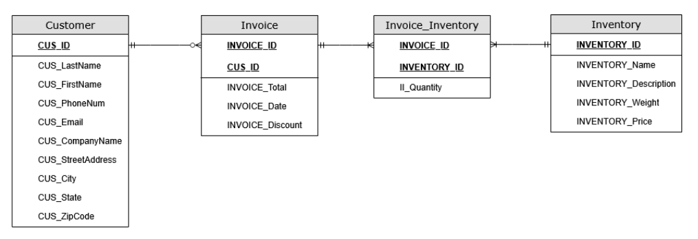
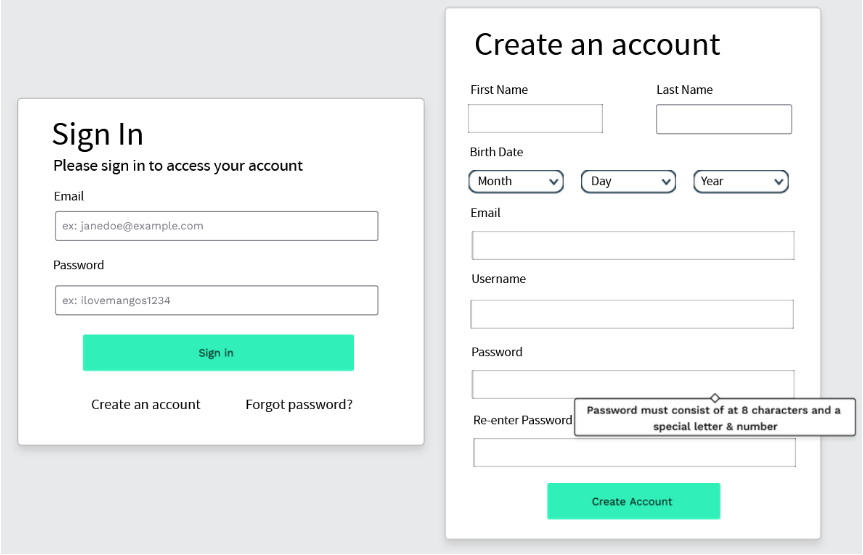

# SDLC Case Study: TopBike Retail Expansion

Capstone systems analysis project for a theoretical retail business,
completed by a team of four for my B.S. in Computer Information
Systems at Fitchburg State University (2025).

## What's inside
**TopBike New System Proposal**: A full system proposal covering feasibility
analysis, requirements, data models, UI prototypes, and a test plan

## My contributions
- Cost-benefit analysis
- Context diagram and level 0 data flow diagram
- Entity relationship diagram (ERD)
- UI prototypes
- Proposal document formatting

## Project summary
Evaluated the technical, economic, and operational feasibility of an
IT modernization plan for a retail expansion scenario, including
cost-benefit analysis and ROI projections.

## Preview

### Entity Relationship Diagram

### UI Prototype

